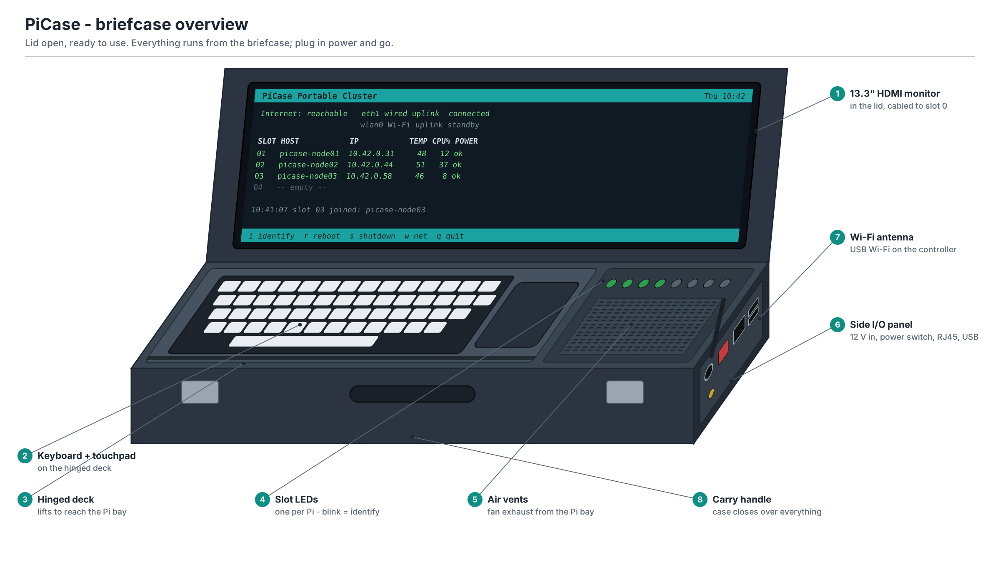
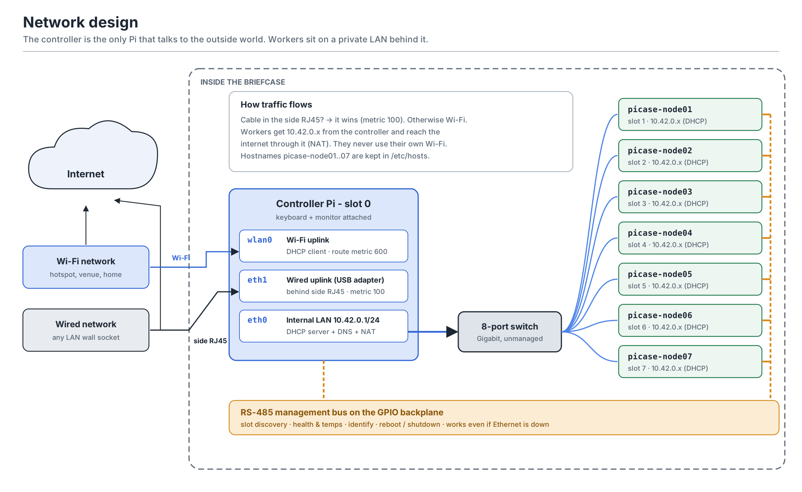
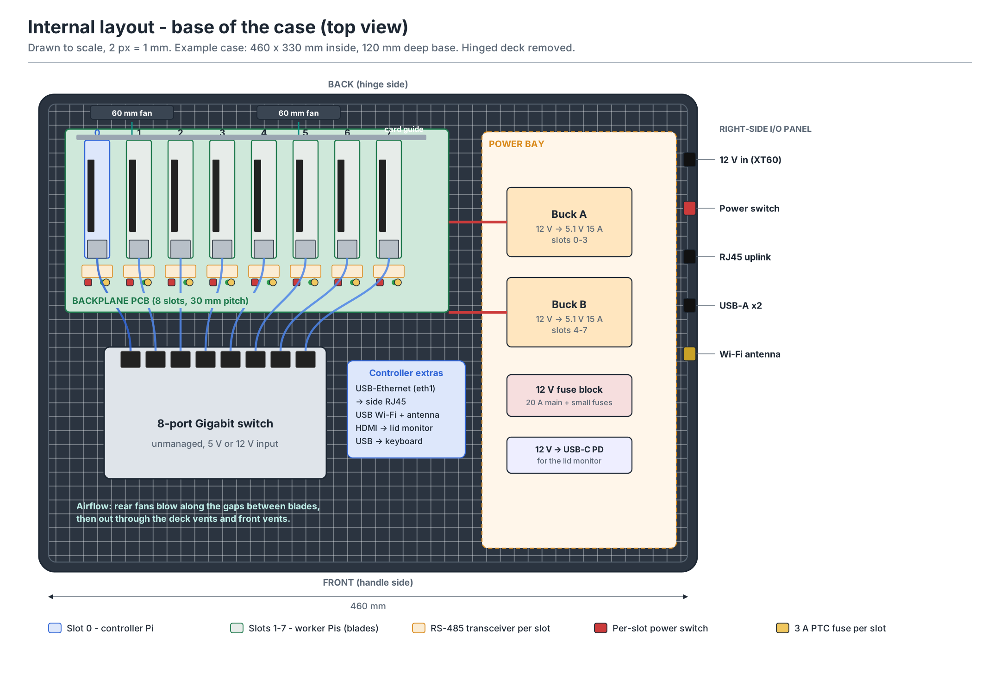
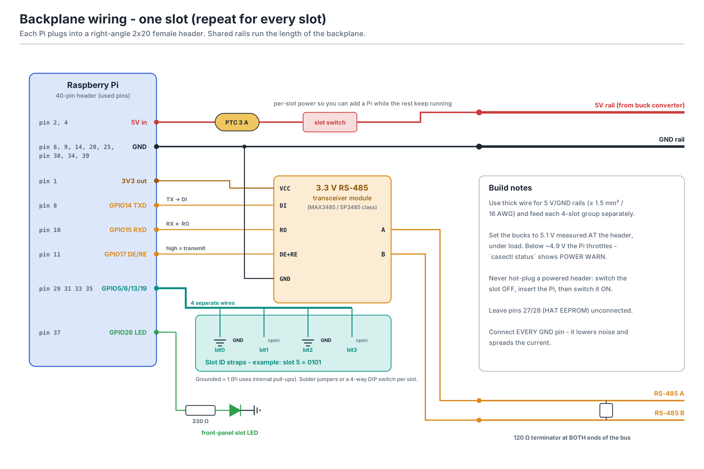
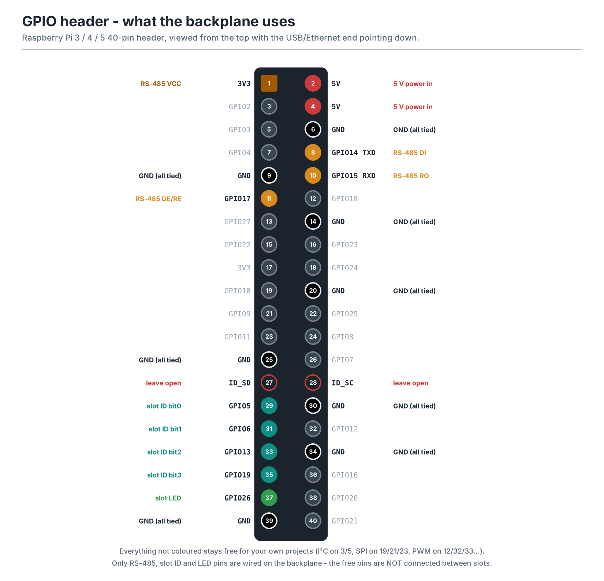
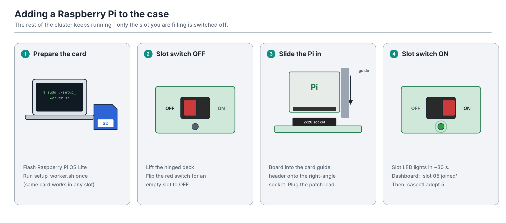

# 1. What you are building

PiCase is a self-contained Raspberry Pi cluster that lives in a hard-shell briefcase. Open the lid, plug in power, and you have a working multi-node server with its own screen and keyboard.



**Key features**

- **One controller Pi** (slot 0) drives a 13.3" monitor in the lid and a keyboard on the deck. It is the only Pi that talks to the outside world.
- **Up to 7 worker Pis** in the prototype (the software supports 15) stand as "blades" in a bay under a hinged deck.
- **Every Pi plugs into a backplane through its 40-pin GPIO header.** The backplane gives each Pi power, a slot number, a status LED, and a connection to a shared management bus.
- **Internet over Wi-Fi or cable.** The controller joins Wi-Fi (or uses the RJ45 port on the side of the case) and shares that connection with every worker.
- **Add Pis while it runs.** Lift the deck, switch an empty slot off, slide a Pi in, switch it on. It appears on the dashboard by itself.

# 2. How it works

## 2.1 Two "buses": data and management

The design uses two separate paths between the Pis, because the GPIO header is good at some jobs and bad at others.

| | Data network (Ethernet) | Management bus (GPIO backplane) |
|---|---|---|
| **Carries** | Everything the servers actually do: SSH, web, file sync, Kubernetes | Slot discovery, temperatures, power warnings, identify, reboot, shutdown |
| **Hardware** | 8-port Gigabit switch + short patch leads | RS-485 transceivers on the UART pins (GPIO14/15) |
| **Speed** | 1 Gbit/s per Pi | 115,200 bit/s (plenty for control messages) |
| **Keeps working if...** | — | ...Ethernet is unplugged, misconfigured or a node has no IP |

> **Why not run the whole network over the GPIO pins?** The header has no Ethernet signals. The fastest practical link over GPIO is the UART at a few Mbit/s — hundreds of times slower than the Ethernet port already on every Pi. So the GPIO backplane does what it is good at (power, identity, out-of-band control) and the Ethernet port does the heavy lifting. If you ever need a GPIO-only data link for a special case, PPP over the same UART is possible, but expect dial-up-era speeds.

## 2.2 Network design



- `eth0` on the controller is the **internal LAN** (10.42.0.1/24). NetworkManager's *shared* mode gives the workers addresses by DHCP and NATs their traffic to whichever uplink is active.
- `eth1` is a **USB-Ethernet adapter** wired to the RJ45 socket on the side of the case. When a cable is plugged in it becomes the preferred uplink (route metric 100).
- `wlan0` is the **Wi-Fi uplink** (metric 600), used whenever there is no cable. Hotspot, venue Wi-Fi, home network — set it from the dashboard by pressing `w`.
- Workers have Wi-Fi switched off; they reach the internet only through the controller.
- The bus master writes `picase-node01`…`picase-node15` into the controller's `/etc/hosts`, so `ssh picase-node03` just works.

## 2.3 The management protocol in one paragraph

Only the controller starts a conversation. Roughly twice a second it walks the slots: an empty slot gets a `PING`, a known node gets a `STATS_REQ`. Workers reply only when addressed, so two Pis never talk at once. Each frame is `0x7E | length | dst | src | type | seq | JSON payload | CRC-16`. A node that misses three polls in a row is marked offline; a slot that answers a `PING` is announced as joined. The full definition is in `software/common/picase_bus.py`.

# 3. Bill of materials

Quantities are for the 8-slot prototype (1 controller + 7 workers). The full list with notes is in `BOM.csv`.

| Qty | Part | Notes |
|---:|---|---|
| 1 | Hard case, approx. 460 × 330 × 170 mm inside | Plastic shell (Pelican / Nanuk / Apache style). Avoid aluminium: it blocks Wi-Fi. |
| 8 | Raspberry Pi 5 (4 GB or 8 GB) | Pi 4 also works with the same code. |
| 8 | microSD 32 GB+ (A2) or NVMe HAT + SSD | NVMe adds thickness — check the 30 mm slot pitch. |
| 8 | Low-profile cooler, ≤ 20 mm tall | Official Pi 5 Active Cooler fits. |
| 1 | 13.3" portable HDMI monitor, USB-C powered | Mounted in the lid. |
| 1 | Slim micro-HDMI → HDMI cable, ~50 cm | Runs through the hinge. |
| 1 | Compact keyboard with touchpad (USB or 2.4 GHz) | Sits in a recess on the deck. |
| 1 | 8-port Gigabit unmanaged switch | 12 V or 5 V input preferred (no extra brick). |
| 8 | Cat6 slim patch leads, 15 cm | Blade → switch. |
| 1 | USB 3 Gigabit Ethernet adapter | Becomes `eth1`, the wired uplink. |
| 1 | Panel-mount RJ45 coupler + 20 cm patch lead | Side panel → USB adapter. |
| 1 | USB Wi-Fi adapter with external antenna (Linux-supported) | Optional; the built-in Wi-Fi works in a plastic case. |
| 2 | Panel-mount USB-A extension | For USB sticks / a spare keyboard. |
| 1 | 12 V, ≥ 15 A (180 W) power supply with XT60 or Anderson lead | External brick keeps mains wiring out of the case. |
| 1 | Panel-mount XT60 (or Anderson Powerpole) socket | Barrel jacks are not rated for 15 A. |
| 1 | 20 A DC-rated rocker switch + inline blade fuse (20 A) | Master power. |
| 2 | 12 V → 5 V adjustable buck converter, ≥ 15 A | One per 4 slots. Set to 5.1 V. |
| 1 | 12 V → USB-C PD module (≥ 30 W) | Powers the lid monitor. |
| 2 | 60 mm 12 V fan + finger guard | Rear wall, blowing along the blades. |
| 1 | Backplane board (large perfboard, or custom PCB) | ~270 × 130 mm. |
| 8 | Right-angle 2×20 female header, 2.54 mm | One per slot — makes the Pis stand as blades. |
| 8 | 3.3 V RS-485 module (MAX3485 / SP3485 class) | One per slot. |
| 8 | Resettable PTC fuse, 3 A hold, ≥ 6 V | Per-slot 5 V protection. |
| 8 | Slide or rocker switch, ≥ 3 A | Per-slot power for safe hot-add. |
| 8 | 4-way DIP switch (or solder jumpers) | Slot ID straps. |
| 8 | 5 mm LED + 330 Ω resistor | Front slot LEDs. |
| 2 | 120 Ω resistor | Bus termination, one at each end. |
| — | 1.5 mm² (16 AWG) red/black wire, 22 AWG hook-up wire, ferrules, screw terminals | |
| — | 3D-printed card guides, mounting plate (3 mm ply or acrylic), M2.5 standoffs, foam | |

**Tools:** soldering iron, multimeter (essential for setting the buck converters), wire strippers, crimper, drill with step bit, jigsaw or rotary tool, 3D printer (or order the guides).

# 4. Mechanical layout



- **Pi bay (left).** The backplane sits on the floor of the case. Each Pi plugs into a right-angle header, so it stands on its long edge like a blade, 30 mm apart. A printed comb (card guide) at the top holds the far edge. Ethernet ports face the front.
- **Switch (front left).** Patch leads drop straight down from each blade.
- **Power bay (right).** XT60 inlet → master switch → fuse → two buck converters → backplane rails. The monitor's USB-C PD module also lives here.
- **Side panel (right wall).** 12 V in, master switch, RJ45 uplink, 2× USB-A, Wi-Fi antenna.
- **Hinged deck.** A 3 mm plate over the Pi bay carries the keyboard and has vents cut in it. It lifts on a piano hinge for access.
- **Lid.** Monitor fixed with VHB tape or a printed bezel. HDMI and USB-C run along the hinge in a loop with enough slack for the lid to open fully.

# 5. Building the backplane

The backplane is the heart of the build. Each slot has the same small circuit; only the slot-ID straps differ.



## 5.1 Pins used on each Pi



| Header pin | Signal | Goes to |
|---|---|---|
| 2, 4 | 5 V | Slot's 5 V after PTC fuse and slot switch |
| 6, 9, 14, 20, 25, 30, 34, 39 | GND | GND rail (connect all of them) |
| 1 | 3.3 V | RS-485 module VCC |
| 8 | GPIO14 / TXD | RS-485 DI |
| 10 | GPIO15 / RXD | RS-485 RO |
| 11 | GPIO17 | RS-485 DE and /RE tied together |
| 29, 31, 33, 35 | GPIO5, 6, 13, 19 | Slot-ID straps (bit 0–3) to GND |
| 37 | GPIO26 | 330 Ω → LED → GND |
| 27, 28 | HAT EEPROM | **Leave unconnected** |

All other pins are left unconnected on the backplane — they are **not** joined between slots.

## 5.2 Slot-ID straps

A grounded strap means "1". The Pi reads them with its internal pull-ups.

| Slot | bit3 (pin 35) | bit2 (pin 33) | bit1 (pin 31) | bit0 (pin 29) |
|---:|:-:|:-:|:-:|:-:|
| 0 (controller) | open | open | open | open |
| 1 | open | open | open | **GND** |
| 2 | open | open | **GND** | open |
| 3 | open | open | **GND** | **GND** |
| 4 | open | **GND** | open | open |
| 5 | open | **GND** | open | **GND** |
| 6 | open | **GND** | **GND** | open |
| 7 | open | **GND** | **GND** | **GND** |

Slots 8–15 continue the binary pattern with bit3 grounded.

## 5.3 Step by step

1. **Lay out the headers** at 30 mm pitch with all their openings facing the same way. Solder them first; everything else fits around them.
2. **Run the rails.** 5 V and GND as 1.5 mm² wire (or wide copper pours on a PCB) along the full length. Split the 5 V rail in the middle: slots 0–3 are fed by buck A, slots 4–7 by buck B. GND is common.
3. **Per slot:** rail → slot switch → PTC fuse → header pins 2 and 4. Connect every GND pin of the header to the GND rail.
4. **Fit one RS-485 module per slot** and wire it as in the table. Tie the module's DE and /RE pins together to GPIO17.
5. **Run the bus.** Two twisted wires (A and B) daisy-chain from module to module. Fit a 120 Ω resistor across A–B **only at the two ends**. Many modules have a 120 Ω resistor already fitted — remove it on every module except the two at the ends.
6. **Set the slot-ID DIP switches** according to the table.
7. **Wire the LEDs** to the front edge of the backplane, or bring them up to the deck with a ribbon cable.
8. **Test before any Pi goes in** (section 9.1).

# 6. Power

| Item | Budget per item | Count | Total at 5 V |
|---|---:|---:|---:|
| Raspberry Pi 5, busy, no USB loads | 3.0 A | 8 | 24 A |
| Controller's USB devices (keyboard, Ethernet, Wi-Fi) | 1.0 A | 1 | 1 A |
| **5 V total** | | | **25 A (≈ 128 W)** |

The switch (~6 W), fans (~3 W) and monitor (~10–15 W) run from 12 V directly. A 180 W, 12 V brick leaves sensible headroom.

1. Wire XT60 inlet → 20 A fuse → master switch → 12 V distribution (screw terminal bar).
2. Connect both buck converters, the switch, the fans and the USB-C PD module to the 12 V bar.
3. **Before connecting the backplane**, power up and set each buck to **5.10 V** with a multimeter.
4. Connect the bucks to the backplane, insert one Pi, run a stress test (`stress-ng --cpu 4`), and measure 5 V **at the Pi's header**. Adjust so it stays between 5.0 and 5.2 V under load.
5. On every Pi 5, allow full USB current when powered through the header. `setup_*.sh` adds `usb_max_current_enable=1`; also run `sudo rpi-eeprom-config --edit` and add `PSU_MAX_CURRENT=5000` to stop the low-power warning at boot.

> **Note:** powering a Pi through its 5 V header pins bypasses the Pi's own input protection. That is why every slot has its own PTC fuse, and why the voltage must be set correctly before any Pi is inserted.

# 7. Software

All code is in the `software/` folder.

```
software/
├── common/picase_bus.py       protocol + transports
├── controller/
│   ├── setup_controller.sh    one-shot setup for slot 0
│   ├── bus_master.py          polls slots, hot-add, /etc/hosts
│   ├── casectl                command-line cluster control
│   ├── console.py             dashboard for the lid monitor
│   └── picase-master.service
├── worker/
│   ├── setup_worker.sh        one-shot setup for any worker
│   ├── bus_agent.py           answers controller, reports health
│   └── picase-agent.service
├── tools/simulate.py          run it all on a laptop
├── tests/test_protocol.py     unit tests
└── optional/install_k3s.sh    Kubernetes (optional)
```

## 7.1 Try it before you build anything

On any computer with Python 3:

```bash
python3 software/tools/simulate.py
python3 -m unittest discover software/tests
```

The simulator boots three virtual workers, hot-adds a fourth, unplugs one and sends commands, using the real master and agent code.

## 7.2 Flash the cards

Use Raspberry Pi Imager → **Raspberry Pi OS Lite (64-bit)**. In the settings, set the username to `pi`, a password, and enable SSH. Flash one card for the controller and one for each worker. Copy the `picase` folder onto each card (or `git clone` it after first boot).

## 7.3 Set up the controller (slot 0)

Boot the controller with the monitor and keyboard attached, then:

```bash
cd picase/software/controller
sudo ./setup_controller.sh --wifi "YourWiFi" "wifi-password" --kiosk
sudo reboot
```

`--kiosk` makes the dashboard open on the lid monitor at boot. Print the controller's SSH key — you will give it to the workers:

```bash
cat ~/.ssh/id_ed25519.pub
```

## 7.4 Set up each worker

On each worker card (on the bench, with a screen, or over SSH on your home network):

```bash
cd picase/software/worker
sudo ./setup_worker.sh --controller-key "ssh-ed25519 AAAA... pi@controller"
sudo poweroff
```

The same card works in **any** slot. At boot the agent reads the slot-ID straps and renames the Pi to `picase-nodeNN`. If you skipped `--controller-key`, run `casectl adopt <slot>` on the controller later.

## 7.5 Day-to-day use

The dashboard shows the uplink, internet status and every slot.

| Key | Action |
|---|---|
| ↑ ↓ | Select a slot |
| `i` | Identify — blink the slot LED for 10 s |
| `r` / `s` | Reboot / shut down the selected node |
| `w` | Wi-Fi and network settings (`nmtui`) |
| `P` | Power off the whole case safely |
| `x` | Drop to a shell (`picase-console` to return) |

From a shell:

```bash
casectl status                  # table of every slot
casectl run "uptime"            # run on every online node over SSH
casectl run -s 2,5 "df -h /"    # ...or only some slots
casectl identify 4              # which physical Pi is slot 4?
casectl reboot 3                # or: casectl reboot all
casectl poweroff-case           # workers first, then the controller
```

**Always use `casectl poweroff-case` (or `P` on the dashboard) before switching the master power off.** Pulling power from running Pis can corrupt SD cards.

## 7.6 Optional: Kubernetes

```bash
./software/optional/install_k3s.sh
```

The controller becomes the k3s server and every online worker joins as an agent. Re-run it after adding Pis.

# 8. Adding more Raspberry Pis



1. Flash a card and run `setup_worker.sh` on it (section 7.4).
2. Lift the hinged deck. Switch the empty slot **OFF**.
3. Slide the Pi into the card guide and onto the header. Plug in its patch lead.
4. Switch the slot **ON**. Within about 30 seconds the slot LED lights and the dashboard shows `slot NN joined`.
5. If you didn't pre-load the controller's key: `casectl adopt NN`.

To go beyond 8 slots, extend the backplane (or chain a second one with the same rails and A/B bus), use a bigger switch, add a third buck converter, and start the master with `--slots 15` (edit `/etc/systemd/system/picase-master.service`).

# 9. Testing checklist

## 9.1 Backplane, no Pis fitted

- [ ] Continuity: every header's GND pins to the GND rail.
- [ ] No short between 5 V and GND (meter on resistance, then on diode test).
- [ ] With power on: 5.1 V on pins 2/4 of every slot **only when its slot switch is ON**.
- [ ] 3.3 V never appears on the rail side (pin 1 is fed by the Pi, not the backplane).
- [ ] Slot-ID pins: grounded exactly per the table in 5.2.
- [ ] Resistance A–B on the bus with power off: ~60 Ω (two 120 Ω in parallel).

## 9.2 With Pis

- [ ] Controller alone: `sudo systemctl status picase-master` is active.
- [ ] One worker: dashboard shows it within 30 s, POWER = ok.
- [ ] `casectl identify N` blinks the right LED.
- [ ] Unplug the worker's Ethernet: it stays visible on the dashboard (management bus is independent).
- [ ] Wired uplink: plug a cable into the side RJ45 — `nmcli dev` shows `eth1` connected and `ip route` uses it first.
- [ ] Remove the cable: internet continues over Wi-Fi.
- [ ] All slots filled, `casectl run "stress-ng --cpu 4 --timeout 600"`: no node reports `POWER WARN`, temperatures stay below 80 °C with the lid open.

## 9.3 Bench-testing the bus with two Pis

Wire two RS-485 modules A-to-A and B-to-B with a 120 Ω resistor at each end, then:

```bash
# Pi 1
sudo python3 /opt/picase/controller/bus_master.py -v --slots 3 --no-hosts
# Pi 2 (no backplane, so force the slot)
sudo python3 /opt/picase/worker/bus_agent.py -v --slot 2
```

# 10. Troubleshooting

| Symptom | Likely cause | Fix |
|---|---|---|
| Slot never appears | Agent not running, UART still used by the login console, slot ID reads 0 | `systemctl status picase-agent`; re-run `setup_worker.sh`; check DIP switch |
| Slots appear and disappear | Missing or extra termination, A/B swapped on one module | Termination at both ends only; check wiring |
| `bus errors` keeps rising | Noise on A/B | Twist A and B together, keep them away from the 5 V wiring |
| POWER shows `WARN 0x50005` or similar | Under-voltage at the header | Raise the buck to 5.15 V, shorten/thicken rail wiring |
| Workers have no internet | Controller `picase-lan` not active, no uplink | `nmcli con up picase-lan`; check the dashboard uplink lines |
| No Wi-Fi in the case | Metal case or antenna inside | Use the USB Wi-Fi adapter with the antenna on the side panel |
| Pi 5 warns about the power supply at boot | EEPROM doesn't know the supply is good | `PSU_MAX_CURRENT=5000` (section 6, step 5) |

# 11. Safety

- Keep mains voltage **outside** the case — use an external, certified 12 V brick. In Australia, any internal mains wiring must be done by a licensed electrician.
- Fuse the 12 V input (20 A) and every 5 V slot (3 A PTC).
- Never insert or remove a Pi with its slot switched on.
- Run with the lid open: the case has no airflow when closed. Shut down before closing.
- Lithium batteries (if you add one later) need a proper BMS, fusing and a fire-safe mounting.

# 12. Ideas for version 2

- A proper KiCad backplane PCB (the pin table above is the netlist).
- Battery pack (LiFePO4 12 V) with a voltage readout on the dashboard.
- Per-slot power switching from the controller (MOSFET load switches driven over the bus) for remote power-cycling.
- PoE HATs and a PoE switch as an alternative to backplane power.
- Fan speed control from CPU temperatures reported over the bus.
