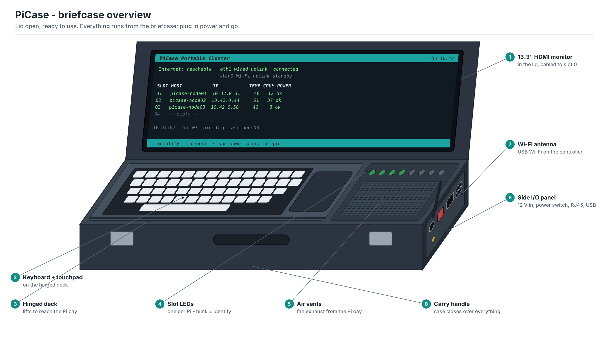

# PiCase — portable Raspberry Pi server in a briefcase

Prototype package: build guide, diagrams, bill of materials and working code for a briefcase cluster with one controller Pi (keyboard + lid monitor) and up to 7 worker Pis plugged into a GPIO backplane. The controller shares Wi-Fi or a wired uplink with every worker, and more Pis can be added while the case is running.



## Start here

1. **Read** `BUILD_GUIDE.pdf` (or `BUILD_GUIDE.md`) — the whole build, start to finish.
2. **Try the software on your laptop** — no hardware needed:
   ```bash
   python3 software/tools/simulate.py
   python3 -m unittest discover software/tests
   ```
3. **Order parts** from `BOM.csv`.
4. **Wire the backplane** using `images/04_backplane_wiring.png` and `hardware/backplane_netlist.csv`.
5. **Install**: `sudo ./software/controller/setup_controller.sh --wifi "SSID" "pass" --kiosk` on the controller, `sudo ./software/worker/setup_worker.sh` on each worker.

## What's in the folder

| Path | What it is |
|---|---|
| `BUILD_GUIDE.pdf` / `.md` | Full build and setup instructions |
| `BOM.csv` | Bill of materials |
| `images/` | Six diagrams (PNG + editable SVG) and the script that draws them |
| `hardware/` | Backplane netlist and pin table |
| `software/common/` | Bus protocol shared by every Pi |
| `software/controller/` | Setup script, bus master service, `casectl`, on-screen dashboard |
| `software/worker/` | Setup script and bus agent |
| `software/tools/` | Simulator |
| `software/tests/` | Unit tests |
| `software/optional/` | k3s (Kubernetes) installer |

## Design in one minute

- **Data** goes over Ethernet: each Pi → 8-port Gigabit switch → controller `eth0` (10.42.0.1, DHCP + NAT).
- **Uplink**: side RJ45 (USB-Ethernet `eth1`, preferred) or Wi-Fi (`wlan0`).
- **The GPIO backplane** gives every Pi 5 V power, a 4-bit slot ID, a status LED and an RS-485 management bus on the UART pins. The controller uses that bus to discover nodes, read temperatures and power warnings, and to identify, reboot or shut them down — even when Ethernet is down.

Status: prototype v0.1. Code tested in the simulator; hardware values (power budget, slot pitch, case size) are design targets to verify on the bench.
